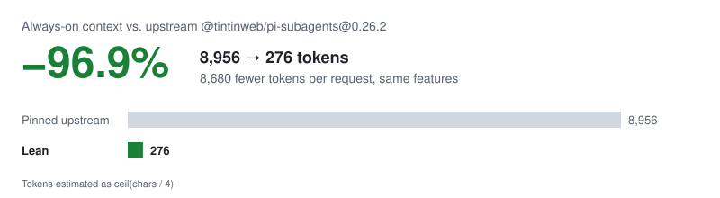

<div align="center">

# pi-subagents-lean

**Full Pi subagents, one compact tool.**

[简体中文](https://github.com/kunkun9527/pi-subagents-lean/blob/main/README_zh-CN.md) · Full setup: [My Lean Pi Setup](https://github.com/kunkun9527/my-lean-pi-setup)

</div>

<!-- token-benchmark:summary:start -->
<p align="center"></p>
<!-- token-benchmark:summary:end -->

A lean version of [`@tintinweb/pi-subagents`](https://github.com/tintinweb/pi-subagents). It runs the upstream `0.23.1` engine as-is and folds its agent tools into one `subagent` tool with a short schema.

## Install

```bash
pi install npm:@ssk_dev/pi-subagents-lean
```

Requires Pi `>=1.1.0` and Node.js `>=22.19.0`. Don't install it alongside upstream or another `pi-subagents` wrapper, or the tools get registered twice.

## Compared with upstream

**Kept**:

- Agent discovery, spawning, background runs, result retrieval, steering and lifecycle handling.
- Upstream's built-in `general-purpose`, `Explore` and `Plan` types, plus any custom agents it discovers.
- The engine itself, untouched: only the model-facing prompt is condensed.

**Trimmed**:

- `Agent`, `get_subagent_result` and `steer_subagent` become one `subagent` tool.
- Advanced parameters and full schemas stay out of the prompt until the model asks with `help`.

**Added**:

- **Forgiving arguments**: a missing `op` is inferred only when unambiguous: `prompt` or `subagent_type` means `run`; `agent_id` means `result`, or `steer` when `message` is also present. Calls mixing both are left to validation. An object `input` is serialized to a JSON string.
- **Agent names in the schema**: `subagent_type` lists the enabled types captured at startup. Reload the extension after changing agent definitions or settings; if upstream's description format isn't recognized, use `help` with `input: "run"`.

## Usage

The model sees one tool, `subagent`, with the operations `run`, `result`, `steer`, `workflow` and `help`.

```json
{
  "op": "run",
  "prompt": "Find the implementation of the cache key.",
  "description": "Locate cache key",
  "subagent_type": "Explore",
  "run_in_background": true
}
```

- `result` with `agent_id` returns a finished task's output.
- `steer` with `agent_id` and `message` redirects a running agent.
- `help` shows upstream's advanced parameters.

## Check your agent definitions

Upstream discovers built-in and custom agents in global, workspace and project directories. This package ships none of my private agents, sessions or memory, but it keeps that discovery. After installing:

1. Make sure each discovered agent's `model` points to a model you have.
2. Remove agent types you don't need.
3. Adjust prompts, tools and extension allowlists to your workflow.
4. Watch for name collisions: a custom agent can override a built-in type of the same name, depending on discovery order.

## Token comparison

<!-- token-benchmark:benchmark:start -->
With only this extension enabled, what the model reads on every turn:

| Variant | Breakdown | Total |
| --- | --- | ---: |
| Lean `@ssk_dev/pi-subagents-lean@0.23.1` | `subagent` (276) | **276** |
| Upstream `@tintinweb/pi-subagents@0.23.1` | `Agent` (2,570) + `SubagentWorkflow` (5,606) + `get_subagent_result` (183) + `steer_subagent` (183) | **8,542** |

<sub>Method: Pi 1.4.0, each variant measured in its own temporary process with an empty working directory and configuration. Built-in tools, skills, context files, session history, user messages, other extensions, runtime UI and slash commands are not counted; `before_agent_start` additions are. Tokens are estimated as `ceil(characters / 4)`, not billed tokens.</sub>
<!-- token-benchmark:benchmark:end -->

## Development

```bash
npm ci
npm run check
```

## License

MIT. The runtime comes from [`@tintinweb/pi-subagents`](https://github.com/tintinweb/pi-subagents) (MIT).
