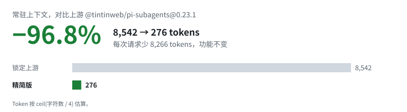

<div align="center">

# pi-subagents-lean

**完整的 Pi 子代理，只占一个工具。**

[English](README.md) · 完整配置：[My Lean Pi Setup](https://github.com/kunkun9527/my-lean-pi-setup)

</div>

<!-- token-benchmark:summary:start -->
<p align="center"></p>
<!-- token-benchmark:summary:end -->

[`@tintinweb/pi-subagents`](https://github.com/tintinweb/pi-subagents) 的精简版。运行时直接用上游 `0.26.2`，我只把它的几个工具合成一个 `subagent`，说明也写得更短。

## 安装

```bash
pi install npm:@ssk_dev/pi-subagents-lean
```

需要 Pi `>=1.1.0`、Node.js `>=22.19.0`。不要和上游或其他 `pi-subagents` 包装同时安装，否则工具会注册两次。

## 和上游比

**保留**：

- Agent 发现、派生、后台运行、取结果、中途引导（steer）和生命周期管理。
- 上游自带的 `general-purpose`、`Explore`、`Plan` 三种类型，以及它发现的自定义 Agent。
- 运行时原样不动，只精简模型看得到的提示。

**精简**：

- `Agent`、`get_subagent_result`、`steer_subagent` 合成一个 `subagent` 工具。
- 高级参数和完整 schema 不常驻，模型用 `help` 查询时才展开。

**新增**：

- **参数容错**：漏传 `op` 时，只在没有歧义时推断：带 `prompt` 或 `subagent_type` 视为 `run`；带 `agent_id` 视为 `result`，再带 `message` 视为 `steer`。两类字段混用时不推断，照常报错。`input` 传成对象时自动转成 JSON 字符串。
- **schema 里列出 Agent 名**：`subagent_type` 列出扩展启动时已启用的类型。改了 Agent 定义或设置后要重新加载扩展；上游描述格式认不出来时，用 `help` 加 `input: "run"` 查询。

## 用法

模型只看到一个 `subagent` 工具，操作有 `run`、`result`、`steer`、`workflow`、`help`。

```json
{
  "op": "run",
  "prompt": "Find the implementation of the cache key.",
  "description": "Locate cache key",
  "subagent_type": "Explore",
  "run_in_background": true
}
```

- `result` 加 `agent_id`：取已完成任务的输出。
- `steer` 加 `agent_id` 和 `message`：调整正在运行的 Agent。
- `help`：查看上游的高级参数。

## 检查你的 Agent 定义

上游会在全局、工作区和项目目录里自动发现内置和自定义 Agent。本包不带我的私有 Agent、会话或记忆，但保留了这套发现机制。装好后：

1. 确认每个 Agent 的 `model` 指向你能用的模型。
2. 删掉用不到的 Agent 类型。
3. 按自己的工作流调整 Prompt、工具和扩展白名单。
4. 注意重名：自定义 Agent 可能按发现顺序覆盖同名的内置类型。

## Token 对比

<!-- token-benchmark:benchmark:start -->
只启用这一个扩展时，模型每轮都会读到的内容：

| 版本 | 构成 | 合计 |
| --- | --- | ---: |
| Lean `@ssk_dev/pi-subagents-lean@0.26.2` | `subagent` (276) | **276** |
| 上游 `@tintinweb/pi-subagents@0.26.2` | `Agent` (2,570) + `SubagentWorkflow` (6,020) + `get_subagent_result` (183) + `steer_subagent` (183) | **8,956** |

<sub>测量方式：Pi 1.4.0，每个版本在独立的临时进程里测，工作目录和配置都是空的。不计内置工具、Skills、上下文文件、会话历史、用户消息、其他扩展、运行时 UI 和 Slash Commands；计入 `before_agent_start` 注入的内容。Token 按 `ceil(字符数 / 4)` 估算，不是实际计费值。</sub>
<!-- token-benchmark:benchmark:end -->

## 开发

```bash
npm ci
npm run check
```

## 协议与致谢

MIT。运行时来自 [`@tintinweb/pi-subagents`](https://github.com/tintinweb/pi-subagents)（MIT）。
